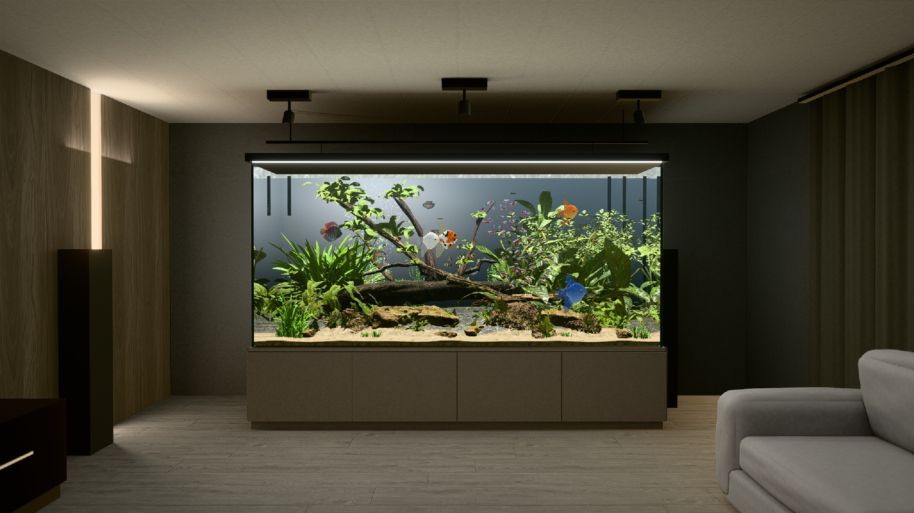
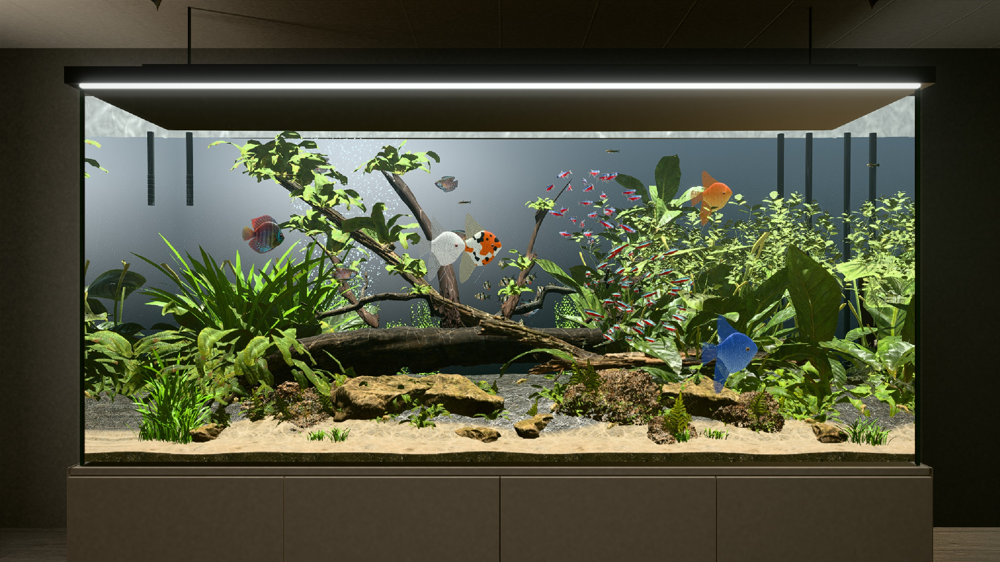

# Fish tank

An experiment with [three.js](https://threejs.org): a live 3D aquarium in a living room, rendered in the browser with WebGPU. It was built over a weekend with Claude Code (Opus 5.5) and Blender.





## What's in it

- **Real-time refraction.** You see the tank's contents bent through the glass and water, including the mirror images on the side panes and under the surface. Each visible pane re-renders the tank, bending the view with Snell's law.
- **Moving water.** The surface ripples and casts caustics, bubbles rise, particles drift, and the water hazes with depth.
- **132 fish of 8 species:** angelfish, discus, dwarf gourami, cardinal tetra, tiger barb, platy, corydoras, and otocinclus.
  - **Shapes:** traced from licensed photos.
  - **Skins:** the photos projected onto those shapes.
- **Fish behaviour:** schools stay together and each fish keeps to its own home area. Fish swim in bursts and glides, hide behind wood, rest near cover, and make leaves shake as they push through.
- **The room:** built in Blender, with its lighting baked in Cycles.
- **Aquascape:** rocks, wood, and plants come from Poly Haven scans.

## Run it

You need a browser with WebGPU, such as a recent Chrome or Edge, and Node 22.12 or later.

```sh
yarn install
yarn dev
```

Then open http://localhost:5173/living-room-fish-tank/. It runs at about 100 fps on an M4 Max MacBook Pro.

## Controls

- **Drag:** move around the tank and up or down.
- **Shift and drag:** slide along the tank.
- **Scroll:** move closer or further away.
- **Click the light switch on the left wall:** step the tank light through 8 colours: daylight, sunrise, sunset, pink, purple, ocean blue, tropical, and moonlight.

## Tests

```sh
yarn test           # simulation and asset tests (Vitest)
yarn test:browser   # rendering, camera, and frame-rate tests in real Chrome (Playwright)
```

## Rebuilding the assets

The built models and textures are committed, so you only need Blender to change them. The build scripts are in `tools/blender/`:

```sh
/Applications/Blender.app/Contents/MacOS/Blender --background --factory-startup --python-exit-code 1 \
  --python tools/blender/build_room.py -- --out public/assets/room
```

## Layout

| Folder | Contents |
| --- | --- |
| `src/tank` | Glass, refraction, mirror panes |
| `src/water` | Surface, caustics, haze, particles |
| `src/fish` | Species, swimming, materials |
| `src/aquascape` | Rocks, wood, plants |
| `src/room` | Living room |
| `src/render` | Render pipeline |
| `tools/blender` | Asset build scripts |
| `reviews` | Notes from each round of visual review |

## License

The code is MIT; see [LICENSE](LICENSE). Images, textures, and models keep their own licenses, and [ASSETS.md](ASSETS.md) lists the source and license of each one. Poly Haven assets are CC0. Some fish skins come from CC BY-SA photos on Wikimedia Commons, so they stay under CC BY-SA, with credit to the photographers.
